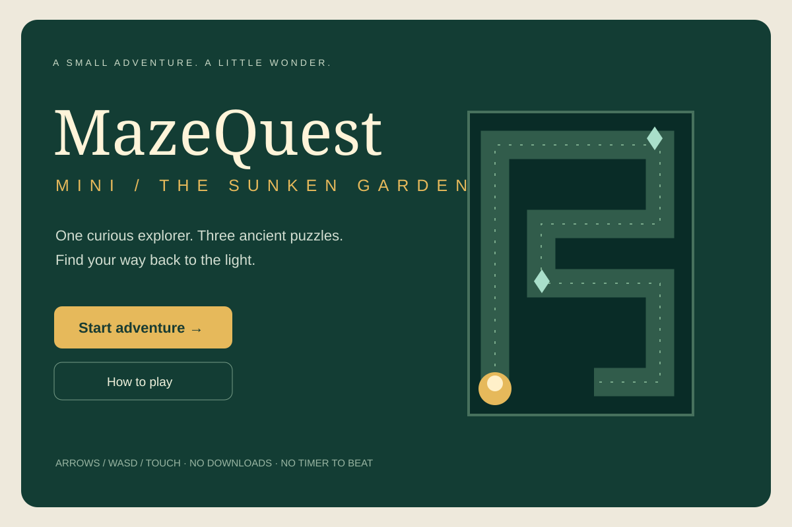
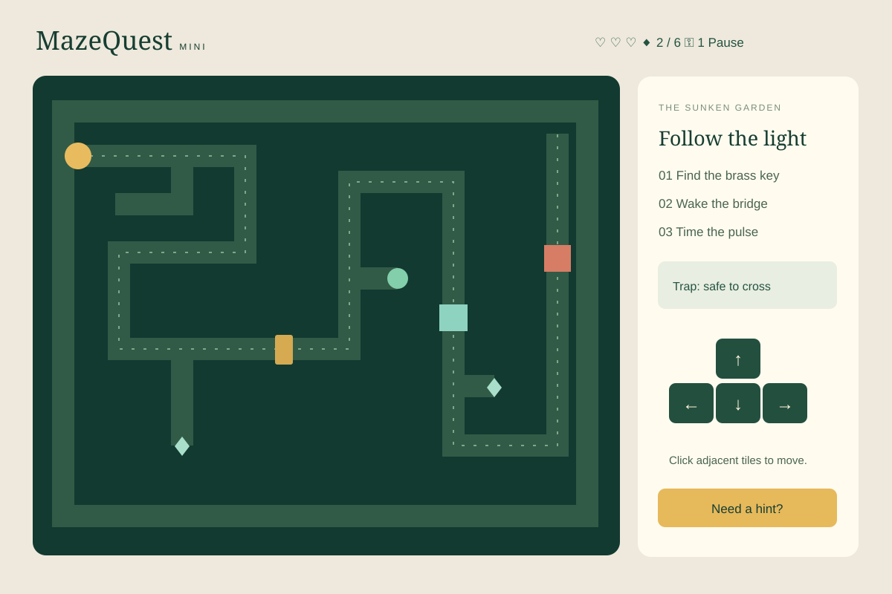

# MazeQuest Mini

**The Sunken Garden** — a tiny top-down puzzle adventure about finding your way back to the light.

Guide **Pip**, a lantern-bearing explorer, through one handcrafted maze. Find the brass key, unlock an ancient gate, wake a moonstone bridge, time a pulsing trap, and collect six optional garden gems.

## Play

Download or clone this repository, then open **index.html** in a modern browser. No build step, package installation, account, or internet connection is needed.

For a local server, run:

```sh
python3 -m http.server 8766 --bind 127.0.0.1
```

Open **http://127.0.0.1:8766** and click **Start adventure**.

## Controls and rules

| Action | Control |
|---|---|
| Move one tile | Arrow keys, WASD, D-pad, or click an adjacent tile |
| Unlock gate | Pick up the brass key, then walk into the gate |
| Activate bridge | Step onto the round switch or click it from an adjacent tile |
| Cross trap | Wait for mint light, enter, and move off before it turns coral |
| Pause | Pause button or Escape; switching away also pauses |
| Instructions | How to play |
| Hints | A gentle hint |
| Restart | Restart level, then confirm |

The pulse alternates between two active and two resting one-second beats. A hit costs one of three hearts and returns Pip to the entrance; puzzle progress and gems are retained. Three hits end the run. The Sun Gate ends the level; gems are optional. A replay starts fresh. There is no save between page reloads.

## Product and design

- [Product requirements](PRD.md): release scope, user flow, rules, and acceptance criteria.
- [Title screen reference](design/01-title.svg): original pre-implementation UI mockup.
- [Level interface reference](design/02-level.svg): original pre-implementation UI mockup.
- [Testing results](TESTING.md): automated and browser verification.





The finished game uses the mockups' parchment, dark garden green, mint, and brass palette; the tile map and responsive controls refine the initial composition. All visual assets are original SVG, CSS, or system-font shapes. No external images, fonts, analytics, ads, or data collection.

## First release checklist

- [x] One 19 × 15 maze with clear entrance and exit
- [x] One controllable character with four-way movement
- [x] Wall and obstacle collision
- [x] Key-locked brass gate
- [x] Clickable/movement-activated switch and bridge
- [x] Timed pulse trap, hearts, checkpoint behavior, and defeat
- [x] Six collectible gems and reward counts
- [x] Start, gameplay, help, pause, restart confirmation, victory, and retry UI
- [x] Keyboard, D-pad, adjacent-tile interaction, and responsive layout
- [x] PRD, two original mockups, automated tests, and CI

## Development and testing

The app is buildless HTML/CSS/JavaScript. `engine.js` contains the standalone rules; `game.js` renders the interface and handles input. Tests use Node's built-in runner, with no dependencies.

Requires Node 18+ only to run tests:

```sh
npm test
```

Alternatively:

```sh
node --test tests/*.test.cjs
```

GitHub Actions runs the suite on Node 22. Automated tests prove a complete route with all six gems and verify that the gate, bridge, and trap each lie on a mandatory path to the exit.

## Vibe-coding approach

The release was developed from a natural-language brief using Codex: write a testable PRD, draw two reference mockups, implement a shared rules engine and interface, test the puzzle topology, and play through the level in a real browser. The verified browser run finished with six gems, three hearts, and 98 moves. See TESTING.md for coverage and limitations.
